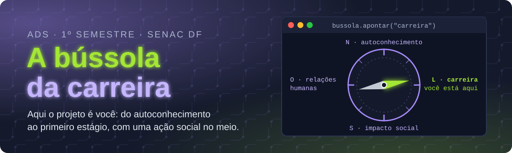

<p align="center">
  
</p>

<p align="center">
  
  
  
  
</p>

<p align="center">
  <b><a href="https://maristelaoliveira.github.io/lab-inovacao-1/">🌐 Abrir o site da disciplina</a></b>
  &nbsp;·&nbsp;
  <b><a href="https://maristelaoliveira.github.io/lab-inovacao-1/#aulas">📚 Ir direto para as aulas</a></b>
  &nbsp;·&nbsp;
  <b><a href="https://maristelaoliveira.github.io/lab-inovacao-1/atividades/card.html">🃏 Montar o Card do Profissional</a></b>
</p>

---

## `>_ whoami`

Prazer, eu sou a **Profa. Maristela**, ou só **Stela**! 👋

Boas-vindas ao **Laboratório de Inovação I**, do curso de **Análise e Desenvolvimento de Sistemas** da Faculdade de Tecnologia e Inovação Senac DF (1º semestre, 70 horas).

Aqui o projeto é **você**. Aula a aula, você monta o seu **portfólio de carreira** e planeja e executa uma **ação de responsabilidade social** ligada à TI. No fim, sai pronto para procurar o primeiro estágio.

Este repositório é o **site da disciplina**: o lugar onde ficam as aulas, os estudos de caso, as atividades e tudo o que a gente usa no semestre. Nada de slides: aqui a aula é o próprio site.

```text
stela@placa ~/lab1 $ bussola --calibrar
Calibrando a bússola da carreira...

  N  autoconhecimento   trajetória, experiências e competências
  O  relações humanas   comunicação, conflitos e liderança
  L  carreira           plano, currículo, LinkedIn e pitch
  S  impacto social     uma ação real, planejada e executada

✔ Norte encontrado. Próximo destino: o primeiro estágio.
```

> 🧭 A bússola não anda por você. Mas mostra o norte.

---

## 🧭 O que tem no site

| | Seção | Para que serve |
|:-:|---|---|
| 🔬 | **A bússola** | O raio-x do tema: do autoconhecimento ao impacto, com o futuro do trabalho em números (e com fonte). |
| 📜 | **Ementa e objetivos** | A ementa oficial, palavra por palavra, e aonde a gente quer chegar. |
| 🗺️ | **Quatro unidades** | Perfil profissional, relações humanas, carreira e responsabilidade social. |
| 📚 | **Aulas** | Uma página por encontro, com conceitos, estudo de caso, atividade e checklist. |
| 🎮 | **Atividades interativas** | Card do Profissional, Simulador Crise na Equipe e os quizzes dos dois bimestres. |
| 📊 | **Avaliação** | Como a nota é montada. Spoiler: não tem prova. |
| 📖 | **Bibliografia** | Os livros para ir além da aula. |
| ♿ | **Acessibilidade** | Tema claro e escuro, aumento de texto (A+) e botão para pausar as animações. |

---

## 🗺️ A trilha do semestre

Quatro unidades, uma bússola. Cada unidade acrescenta uma peça ao seu portfólio:

```python
portfolio = {
    "Unidade 1 · aulas 1 a 5":   "perfil profissional e autoconhecimento",
    "Unidade 2 · aulas 6 a 9":   "relações humanas e liderança",
    "Unidade 3 · aulas 10 a 13": "estratégias e gestão de carreira",
    "Unidade 4 · aulas 14 a 17": "responsabilidade social",
}

for unidade, peca in portfolio.items():
    print(f"🧩 {unidade}: {peca}")

print("🎒 Portfólio de carreira pronto. Bora para o estágio!")
```

| Aula | Tema | |
|:-:|---|:-:|
| 01 | Bem-vindo ao Laboratório de Inovação I | [abrir](https://maristelaoliveira.github.io/lab-inovacao-1/aulas/aula-01.html) |
| 02 | Minha trajetória até aqui | [abrir](https://maristelaoliveira.github.io/lab-inovacao-1/aulas/aula-02.html) |
| 03 | Qualificações e experiências anteriores | [abrir](https://maristelaoliveira.github.io/lab-inovacao-1/aulas/aula-03.html) |
| 04 | Habilidades, talentos e competências | [abrir](https://maristelaoliveira.github.io/lab-inovacao-1/aulas/aula-04.html) |
| 05 | Perfil profissional em ADS | [abrir](https://maristelaoliveira.github.io/lab-inovacao-1/aulas/aula-05.html) |
| 06 | Relações humanas e comunicação no trabalho | [abrir](https://maristelaoliveira.github.io/lab-inovacao-1/aulas/aula-06.html) |
| 07 | Conflitos, ética e convivência profissional | [abrir](https://maristelaoliveira.github.io/lab-inovacao-1/aulas/aula-07.html) |
| 08 | Liderança e protagonismo | [abrir](https://maristelaoliveira.github.io/lab-inovacao-1/aulas/aula-08.html) |
| 09 | Entrega do 1º bimestre: portfólio de autoconhecimento | [abrir](https://maristelaoliveira.github.io/lab-inovacao-1/aulas/aula-09.html) |
| 10 | Estratégias de carreira em TI | [abrir](https://maristelaoliveira.github.io/lab-inovacao-1/aulas/aula-10.html) |
| 11 | Ser empregado ou empregador? | em breve |
| 12 | Gestão de carreira: meu plano de carreira | em breve |
| 13 | Currículo, LinkedIn e pitch pessoal | em breve |
| 14 | Responsabilidade social em TI | em breve |
| 15 | Planejamento da ação social | em breve |
| 16 | Ajustes finais e ensaio da apresentação | em breve |
| 17 | Apresentação do projeto final | em breve |
| 18 | Avaliação final de recuperação | em breve |

> 🎓 **Está em dependência?** Você segue as mesmas aulas por este site, no seu ritmo, e entrega tudo no Moodle. Quando a atividade depende da turma, a aula traz o caminho da dependência.

---

## 🎮 Atividades interativas

Funcionam no computador e no celular. O que você digita fica salvo só no seu navegador.

| | Atividade | O que você faz | Aulas |
|:-:|---|---|:-:|
| 🃏 | [**Card do Profissional**](https://maristelaoliveira.github.io/lab-inovacao-1/atividades/card.html) | Monta o seu perfil em formato de card de jogo (curso, perfil, hard skills, soft skills e talento) e baixa a imagem para o portfólio. | 4, 5 e 13 |
| 🔥 | [**Simulador Crise na Equipe**](https://maristelaoliveira.github.io/lab-inovacao-1/atividades/simulador.html) | Cinco decisões numa semana de projeto. Cada escolha mexe na confiança da equipe, na entrega e na sua reputação. | 7 |
| ❓ | [**Quiz do 1º bimestre**](https://maristelaoliveira.github.io/lab-inovacao-1/atividades/quiz.html?b=1) | Dez perguntas com explicação para revisar as aulas 1 a 8. | 9 |
| ❓ | [**Quiz do 2º bimestre**](https://maristelaoliveira.github.io/lab-inovacao-1/atividades/quiz.html?b=2) | Dez perguntas com explicação para revisar as aulas 10 a 16. | 16 e 18 |

> 🔑 O Card e o Quiz usam o login com o **e-mail da faculdade** (`@edu.df.senac.br`), para o seu resultado chegar até a professora.

---

## 🛠️ Ferramentas da disciplina

<p align="center">
  
</p>

| Ferramenta | Para quê |
|---|---|
| 💬 **Teams, Loop e Whiteboard** | Combinar, debater e montar o portfólio numa página sua do Loop. |
| 🎓 **Moodle** | Entregar as atividades (e acompanhar tudo, se você está em dependência). |
| 📘 **Microsoft Learn** | Estudar no seu ritmo. |
| 🐙 **GitHub** e o **Curso de GitHub** | Dar os primeiros passos no lugar onde dev mostra o que sabe. |
| 💼 **LinkedIn** | O seu perfil profissional on-line. |
| 📋 **Planner e Forms** | Planejar a ação social e medir o impacto. |
| 🎤 **PowerPoint com Speaker Coach** | Ensaiar o pitch pessoal sem gaguejar. |
| 🤖 **Copilot do Microsoft 365** | Ajudar a escrever e revisar, com senso crítico. |

---

## 🤖 IA com consciência

O Copilot do Microsoft 365 ajuda a escrever e revisar. **Você confere cada sugestão.** Currículo com experiência inventada pela IA não é currículo: é ficção. 😉

> A IA pode até sugerir a frase, mas a história é sua. Ninguém conta a sua trajetória melhor que você.

---

## 📊 Como a nota é montada

Dez pontos por bimestre. Aqui não tem prova: a nota vem do seu portfólio.

| 1º bimestre (10 pontos) | | 2º bimestre (10 pontos) | |
|---|:-:|---|:-:|
| Relatório de Perfil Profissional (aula 8) | 4,0 | Projeto final: portfólio de carreira e ação social (aula 17) | 7,0 |
| Portfólio de autoconhecimento com explicação (aula 9) | 6,0 | Avaliação Integrada | 2,0 |
| | | Participação na Jornada Interdisciplinar | 1,0 |

Para ser aprovado: **média final 6,0** e pelo menos **75% de frequência**.

```text
stela@placa ~/lab1 $ bussola --rota aprovacao
⚠ Rota recalculada: frequência abaixo de 75%.
```

> Esse aviso a gente não quer ver. Venha às aulas! 😉

---

## 🙋 Dicas de sobrevivência

1. **Experiência não é só emprego.** Formatou o computador da família? Montou a rede da igreja? Conta, sim. É só saber contar.
2. **Hard skills abrem a porta; soft skills mantêm você lá dentro.** Treine as duas.
3. **"Aprender programação" não é meta.** Meta tem número e prazo: "terminar o curso de 40h até 30 de novembro" é.
4. **Atualize o portfólio toda aula.** Deixar tudo para a aula 17 é o famoso "deploy na sexta à noite". 😅
5. **Travou?** Pergunte no Teams. Ninguém nasce com o LinkedIn pronto.

---

<details>
<summary><b>👩‍🏫 Para a professora (estrutura do repositório)</b></summary>

<br>

Site estático publicado no GitHub Pages a partir da branch `main`, sem build e sem dependências.

```text
lab-inovacao-1/
├── index.html              # página da disciplina (bússola, ementa, unidades, aulas, atividades, avaliação, bibliografia)
├── aulas/
│   └── aula-NN.html        # uma página por aula (por enquanto, da 01 à 10)
├── atividades/
│   ├── card.html           # Card do Profissional (com login)
│   ├── simulador.html      # Simulador Crise na Equipe
│   └── quiz.html           # Quiz de revisão (?b=1 e ?b=2)
└── assets/
    ├── css/  js/           # visual comum dos sites da Stela; card.js, quiz.js, simulador.js e conta.js (login)
    └── img/                # ícones, logo, a bússola e o banner deste README
```

- Aula nova: copie uma `aulas/aula-NN.html` pronta, troque o conteúdo e ligue o link "abrir a aula →" na lista de aulas do `index.html`.
- Perguntas dos quizzes: a constante `BANCO`, no começo de `assets/js/quiz.js` (uma lista por bimestre).
- Os arquivos de `assets/css` e `assets/js` que são o visual comum (estilo.css, neon.css, placa.js…) são cópia do portal: edite lá.
- Antes de publicar: testar no navegador, também na largura de celular (390 px).

</details>

---

<p align="center">
  Feito com ♥ e sucata eletrônica pela <a href="https://maristelaoliveira.github.io/">Profa. Maristela</a> · Faculdade de Tecnologia e Inovação Senac DF
  <br>
  <code>bussola.apontar("carreira")</code>
</p>
